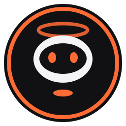

<div align="center">



# NEXI — Your Focus Companion

**A local-first Windows desktop companion that tracks where your time goes and gently keeps you on task.**

[](CHANGELOG.md)
[](#requirements)
[](#requirements)
[](https://doc.qt.io/qtforpython-6/)
[](#privacy--data)

[Download](https://github.com/ab2030909/NEXI-focus-companion/releases) ·
[Features](#features) ·
[Quick Start](#quick-start) ·
[Browser Extension](#browser-extension-optional) ·
[Changelog](CHANGELOG.md)

</div>

---

## Table of Contents

- [Overview](#overview)
- [Features](#features)
- [Quick Start](#quick-start)
- [Configuration](#configuration)
- [Browser Extension](#browser-extension-optional)
- [AI Habit Coach](#ai-habit-coach-optional)
- [Privacy & Data](#privacy--data)
- [Architecture](#architecture)
- [Project Structure](#project-structure)
- [Building from Source](#building-from-source)
- [Known Limitations](#known-limitations)
- [Contributing](#contributing)
- [Versioning & Changelog](#versioning--changelog)

---

## Overview

NEXI watches which application and website is in the foreground, classifies it
(Coding, Productivity, Communication, Entertainment, Social Media, Gaming, …),
and turns that into focus analytics. When a distraction rule is hit, NEXI shows
a supportive prompt instead of closing anything behind your back.

Everything runs on your machine. The AI coach is optional, and the app is fully
usable offline without an API key.

## Features

### Tracking
- **Foreground activity detection** through native Win32 calls (`GetForegroundWindow`, `QueryFullProcessImageNameW`).
- **Idle detection** (`GetLastInputInfo`) so away-time does not distort your metrics.
- **Website hostname detection** for Chrome, Edge and Brave via the companion extension, with window-title and UI Automation fallbacks.
- **Editable classification rules** for apps and domains, plus exclusion lists.

### Focus
- **Focus sessions** with presets (Deep Work, Coding, Study, Relax, Custom), countdown and break states.
- **Intent Mode** (bounded browsing): declare a goal and time budget before visiting a site like YouTube or Reddit. Persists across restarts.
- **Distraction interventions**: watched sites, short-form video limits and continuous-distraction rules, with actions *Return to Focus*, *Take a Break*, *Snooze* and *Continue*.
- **Reminders** on custom intervals or schedules, with quiet hours.

### Insight
- **Focus Center dashboard**: screen time, productive time, distractions, daily goal, top apps and top domains.
- **Focus Radar**: Today / 7-day / 30-day views, 24-hour distribution and productive-vs-distracting trends.
- **Activity timeline** with category filtering.

### Experience
- **System tray** controls and optional **start with Windows** (per-user, no admin rights).
- **Floating mascot** with nine animated states (idle, focused, warning, celebrating, sleepy, confused, …). Draggable; double-click to open the dashboard.
- **Theme Studio**: NEXI Dark, Midnight Orange, OLED Black, Warm Light and fully custom colors, plus density, corner style and reduced-motion options.

## Quick Start

### Option A — Standalone executable (recommended)

1. Download `NEXI-v1.0.0-windows-x64.zip` from [Releases](https://github.com/ab2030909/NEXI-focus-companion/releases).
2. Extract it and run `NEXI.exe`. No Python needed.
3. Verify the download against `checksum.sha256.txt` if you wish.

### Option B — Run from source

```bash
git clone https://github.com/ab2030909/NEXI-focus-companion.git
cd NEXI-focus-companion
pip install -r requirements.txt
python main.py
```

### Requirements

| Component | Requirement |
|-----------|-------------|
| OS        | Windows 10 or 11 |
| Python    | 3.11, 3.12 or 3.13 (source runs only) |
| Packages  | `PySide6>=6.6.0`, `groq>=0.9.0`, `pywin32>=306` |

## Configuration

Most settings live in the app under **Settings**. A reference of the
environment variables is in [`.env.example`](.env.example).

| Variable | Purpose | Default |
|----------|---------|---------|
| `GROQ_API_KEY` | Enables the AI habit coach | unset (offline) |
| `FOCUS_COMPANION_DB` | Override database file location | `%APPDATA%\FocusCompanion\focus_companion.db` |

The extension port is configured in the app's settings (default `19876`).
It must match the port used by the extension, see [Known Limitations](#known-limitations).

## Browser Extension (optional)

The Manifest V3 extension gives exact hostnames instead of title heuristics,
and lets NEXI pause a playing video behind an intervention.

1. Open `chrome://extensions/`, `edge://extensions/` or `brave://extensions/`.
2. Enable **Developer mode**.
3. Click **Load unpacked** and select the `focus_companion/browser_extension` folder.

**What it sends:** only the normalized hostname of the active tab, to
`http://127.0.0.1:19876` on your own machine. For incognito tabs it reports
only that incognito is active, never the domain. It does not send full URLs,
page content, or keystrokes.

**Permissions:** it requests `tabs`, `scripting` and `<all_urls>` host access.
Hostname reporting does not read page content; `scripting` is used solely to
pause video elements in the active tab on request.

## AI Habit Coach (optional)

1. Create a key in the [Groq Console](https://console.groq.com/).
2. Open **Settings → NEXI AI Coach** and paste the key.

When used, aggregated usage totals and the names of your top apps and sites are
sent to Groq to generate insights and focus plans. Raw activity logs and
window titles are not sent. Leave the key empty to keep everything offline.

## Privacy & Data

- All activity is stored locally in SQLite at `%APPDATA%\FocusCompanion\focus_companion.db`. The database is **not encrypted**; protect it with your normal Windows account and disk security.
- No screenshots, keystrokes, passwords, full URLs or query strings are recorded.
- The activity table stores the foreground window title for apps, which can include document or page names.
- **Clear History** and **Reset Settings** are available in Settings.
- NEXI never closes tabs or terminates applications on its own.

## Architecture

```
 Win32 / Browser Extension
          │  foreground app, idle time, hostname
          ▼
   ActivityTracker (QThread, 1 s poll)
          │  signals: tick, activity_changed
          ▼
      MainWindow ──► InterventionManager ──► InterventionDialog
          │               ▲                        │
          │               └────── user action ─────┘
          ├──► FocusEngine  (sessions, breaks, intent mode)
          ├──► ReminderScheduler
          ▼
   Repository ◄──► SQLite (settings, rules, activity, sessions)
          ▲
          └── Dashboard · Timeline · Rules · Radar · Settings pages
```

The tracker batches activity and flushes to SQLite on context change or about
every 30 seconds. The UI layer wires tracker signals to the intervention and
reminder logic.

## Project Structure

```
.
├── main.py                      # Application entry point
├── NEXI.spec                    # PyInstaller specification
├── build.bat                    # Reproducible Windows release build
├── requirements.txt
├── .env.example
├── CHANGELOG.md
├── VERSION
└── focus_companion/
    ├── assets/                  # Icons
    ├── browser_extension/       # Optional Chromium MV3 extension
    └── app/
        ├── core/                # tracker, browser_tracker, focus_engine,
        │                        # intervention, notifications
        ├── database/            # db (schema/seed), repository (queries)
        ├── integrations/        # groq_client
        ├── utils/               # win_api (Win32, startup registry)
        └── ui/
            ├── main_window.py
            ├── pages/           # home, timeline, rules, radar, settings
            ├── dialogs/         # intervention, intent
            ├── components/      # theme, charts, cards, icons
            └── mascot.py        # animated companion
```

## Building from Source

```cmd
build.bat
```

This cleans previous output, runs PyInstaller with the bundled Qt runtime and
app icon, generates a SHA-256 checksum, and writes:

- `release/NEXI-v1.0.0/`
- `release/NEXI-v1.0.0-windows-x64.zip`

## Known Limitations

- The extension is hard-coded to port `19876`; changing the port in Settings disconnects it.
- Hostnames reported by the extension are not tied to a specific browser window, so a stale domain can briefly be attributed after switching between Chromium browsers.
- Some intervention settings (video-pause toggle, short-video limit, snooze duration) use setting keys that differ between the UI and the engine and may not take effect yet.
- The short-form "daily budget" is stored but not yet enforced; only continuous duration is checked.
- Windows only. There are no automated tests yet.

## Contributing

Issues and pull requests are welcome.

1. Fork the repository and create a branch: `git checkout -b feature/your-change`
2. Keep changes focused and follow the existing code style.
3. Test manually with `python main.py` on Windows.
4. Update [CHANGELOG.md](CHANGELOG.md) for user-visible changes.
5. Open a pull request describing what and why.

## Versioning & Changelog

NEXI follows [Semantic Versioning](https://semver.org/). See
[CHANGELOG.md](CHANGELOG.md) for release history.

---

<div align="center">
<sub>Built with PySide6 · Local-first by design</sub>
</div>
